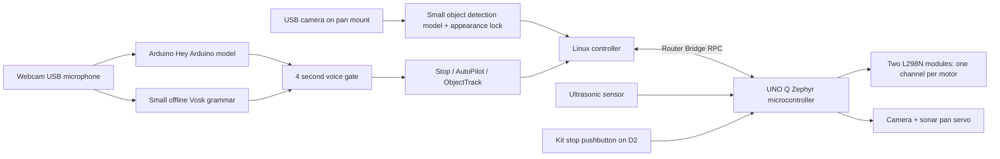

# Architecture and behavior limits

## Independent motor envelope

The MCU starts disarmed, disables PWM enables and neutralizes direction inputs before starting Bridge, and does not wait for a Serial Monitor to attach. Its loop maintains the pins; Bridge handlers update mutex-protected desired state and disable outputs immediately when stopping, rearming or rejecting an invalid command. It rejects out-of-range commands, full reverse, stale commands, stale/no echo, movement while sensors are panned away or settling, and physical stop inputs.

- Host command lease: 500 ms; one bounded 25 ms ultrasonic read and loop/scheduling overhead can add to response time. This is not a measured safety certification.
- Maximum absolute PWM: 110/255. Defaults: cruise 85, follow 70, turn 70.
- Sonar valid range: 20–4000 mm; timeout/no echo is **unknown**, not “clear”.
- Range freshness: at most 250 ms, measured independently on MCU.
- Pan must be within 87–93° and settled at least 400 ms to move.
- Translation requires >300 mm; pivots require >180 mm. Host normally stops translation earlier at 350 mm.
- Emergency switch or command expiry disarms. Clearing the fault does not automatically arm; a new mode selection is required.

This is a motion-command lease, not a hardware MCU watchdog reset. If firmware/MCU itself hangs while outputs remain asserted, only a separate motor-power cut guarantees a stop. `stop_car` disables outputs under the shared mutex immediately; the button is polled each loop, not hardwired to the power supply. The default kit pushbutton is pressed LOW and does not detect an unplugged wire. Optional NC mode detects an open wire, but not a wire shorted to ground. Neither switch replaces a motor-supply disconnect.

## L298N output and power interface

Each module controls one side: IN1/IN3 and IN2/IN4 share that side's direction signals, ENA/ENB share PWM, and each motor has a separate output pair. `L298N.h` neutralizes direction inputs on stop and removes PWM for 200 µs before reversing a powered side. There is no standby pin. The four hardware enable pull-downs hold outputs disabled before firmware runs; remove all four enable jumpers. Zero commands coast rather than actively brake. Actual coast stopping distance must be measured.

The low-purchase power plan separates the motor battery from a USB power bank feeding Q and a separately wired 5 V peripheral branch. It requires checking the actual bank/hub/servo current ratings. Linux and MCU cannot detect an inadequate power bank, disconnected stop button, hot driver or low motor battery with the current sensors. Detailed connections are in [WIRING.md](WIRING.md).

## AutoPilot

The controller prefers forward progress. On a nearby sonar reading or a large central AI box it stops, pans the shared camera/sonar left then right, and gathers settled range + fresh AI evidence for each angle. It selects a clear sector, penalises repeating the last turn, recentres, and makes one bounded pivot. It rechecks the forward path after turning. Scan failures, no usable exit, or five turns within 20 seconds return to Stop. An occasional short pivot breaks very long straight runs.

There is no blind reverse recovery. A very close front obstacle can prevent even a pivot; move the car manually after stopping. Timing turns cannot guarantee an angle on slippery floors. There are no encoders, odometry, SLAM, coverage map or visited-location guarantee. “Avoid going in circles” is implemented by short turns, forward preference, repeated-turn penalties and a stuck stop; it is not proof of exploration in an arbitrary maze.

## Object Track

Mode entry starts a new one-time capture after 3 seconds. A centre-containing AI bounding box helps select the subject, otherwise a central 30% region is used. A frozen grayscale appearance template searches at several scales. It requires consecutive confident, unambiguous matches; low texture, low confidence, multiple lookalikes or a missing object yield no motion target. The original template stays frozen to reduce identity drift.

The chassis turns toward the target's horizontal centre and advances only if its apparent area is smaller than the area at capture. It stops at the captured size or for an obstacle. It never drives backward to regain distance. Tracking keeps the camera/sonar centred; when the item is lost it waits with no sweep or chassis search. A matching item returning to the frame can be reacquired after confirmation. Similar-looking objects can still be confused; major rotations/deformations and large scale changes often prevent reacquisition. Say Object Track again to intentionally recapture a subject.

Recognised target boxes overlapping the appearance lock are excluded from the coarse AI obstacle box rule, while sonar still protects distance to them. A single front sonar cannot distinguish the target from an intervening obstacle, so either causes a hold at the range threshold. Lost targets do not cause the app to silently switch to another AI object class.

## Vision and audio freshness

Frames are resized to exact model input dimensions before inference. Boxes are normalized using the public model information; camera pixels and model pixels are not mixed. A successful empty detection dictionary is distinct from a failed/None inference. Failure stops the vision worker and latches Stop. AI timestamps refer to image capture, not inference completion, so delayed inference cannot renew freshness for old images. Freshness holds can resume when fresh data returns; fatal camera/audio/Bridge failures disarm and require mode selection again.

One microphone capture feeds the official keyword model unchanged and a bounded queue of int16 mono PCM to Vosk. Wake detection opens the command window and immediately requests Stop while listening. Only exact recognized grammar commands are accepted within that window; unrecognized phrases do nothing. A short recent transcript handles a one-breath command finishing before the wake-model callback. Mode changes are queued onto the single control thread, which owns all motor RPC calls. Initialization, queue overflow, stale audio and worker faults fail stopped.

## Limits of obstacle sensing

Object boxes are visual caution cues, not depth or traversability estimates. YOLO does not detect every wall, cord, furniture leg, drop or transparent object. HC-SR04 can miss angled/soft surfaces, has a limited beam and no side/rear coverage; sideways collisions while pivoting remain possible. The safe use case is a slow, supervised hobby robot on an uncluttered level floor. For more capable navigation, add appropriate side/rear ranging, bumpers, cliff sensing, wheel encoders and mapping rather than removing the current checks.
